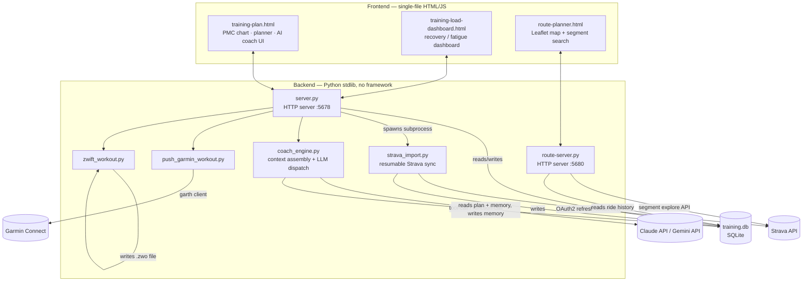

# FormForward

A self-hosted training management system built around the **Performance Management Chart (PMC)** — the model coaches use to track Chronic Training Load (CTL), Acute Training Load (ATL), and Training Stress Balance (TSB) over time. FormForward syncs completed rides from Strava, estimates training load per activity, and projects the PMC curve *forward* from planned workouts so you can see where your fitness and freshness will land on race day — then push the plan straight to your head unit.

It also includes an LLM-based training coach that reads your real training history and proposes plan changes as structured, human-reviewed edits rather than free-text suggestions.

## Features

- **Forward-projected PMC chart** — CTL/ATL/TSB computed from actual Strava history, then extended using planned future workouts, so the fitness/fatigue/form curve reflects what *will* happen, not just what already did.
- **Automatic Strava sync** — resumable, paginated import of ride history with HR-zone and lap-level detail backfill; a scheduled background sync keeps the dataset current without manual intervention.
- **Per-activity TSS estimation** — power-based (normalized power vs. FTP) for cycling, HR-based (hrTSS vs. LTHR) for running, with a `suffer_score` fallback for activities without a power meter. The model is calibrated against real ride data (see [DEVELOPMENT.md](DEVELOPMENT.md)).
- **AI training coach** — an agent (Claude or Gemini, selectable per-session) that is handed a deterministic context payload — current PMC state, 14-day compliance, upcoming plan, persistent coaching rules — and responds with a *structured* tool call (`propose_plan_updates`) rather than prose. Proposed workout changes are validated (dates, required fields) before the user approves and applies them. The coach also maintains its own long-term memory of rules/goals/observations in SQLite, so corrections persist across sessions.
- **One-click device push** — send a planned workout straight to **Garmin Connect** (structured interval steps with HR/power-zone targets, built directly against Garmin's internal workout API via [`garth`](https://github.com/matin/garth)) or generate a **Zwift** `.zwo` workout file, parsing target power from the workout's plain-text notes.
- **Route planner** — a separate mini-app that uses Strava's segment-explore API to find real segments near your usual riding area matching a target interval duration, so structured intervals can be ridden outdoors on an actual hill instead of a trainer.
- **Manual TSS overrides** — correct a miscalculated activity (e.g., a mismatched Strava auto-detection) without touching the underlying Strava data.

## Architecture



| Component | Role |
|---|---|
| `server.py` | Main HTTP server. Serves the frontend, exposes the `/api/*` JSON endpoints, owns all SQLite access, runs a background thread that syncs Strava every weekday morning. |
| `training-plan.html` | The primary UI — PMC chart (Chart.js), weekly planner table, settings, and the AI coach chat panel. Single file, no build step. |
| `training-load-dashboard.html` | A secondary dark-themed dashboard focused on acute recovery / fatigue-deficit tracking. |
| `strava_import.py` | Standalone script that pages through the Strava API (OAuth2 refresh-token flow, zero third-party dependencies required — falls back from `requests` to `urllib` automatically) and upserts activities into `training.db`. Cursor-based resume means it can be interrupted and picked back up exactly where it left off. Runs both as a CLI tool and as a subprocess spawned by `server.py`. |
| `coach_engine.py` | Assembles a complete, deterministic snapshot of training state (PMC numbers, 14-day history, upcoming plan, persistent memory) and sends it to an LLM with a strict output schema (`propose_plan_updates`). Supports Anthropic Claude (tool use) and Google Gemini (function calling, with an automatic model-cascade failover on rate limits / overload). Nothing is written to the database until the human approves the proposal. |
| `push_garmin_workout.py` / `garmin_auth.py` | Build a Garmin Connect structured workout (warmup → intervals/recovery → cooldown, HR or power-zone targets) from a planned workout's notes and push it via the unofficial `garth` client. `garmin_auth.py` performs one-time login (with MFA support) and caches the session token. |
| `zwift_workout.py` | Parses target power (`%FTP` or explicit watts) out of a workout's free-text notes and generates a Zwift-compatible `.zwo` XML file, archiving any previous workout so only the current one shows up in-game. |
| `route-planner.html` + `route-server.py` | A separate tool (own port, own small server) that finds real Strava segments near your typical ride start point matching a target duration — useful for turning a prescribed interval into an actual outdoor route. |
| `strava_api/` | An earlier, standalone Strava integration experiment (AWS Lambda + Postgres instead of the SQLite path above). **Not used by the live app** — kept for reference. See its own [README](strava_api/README.md). |

## Tech stack

- **Backend**: Python 3, standard library only for the core app (`http.server`, `sqlite3`, `urllib`) — no web framework, no ORM.
- **Frontend**: Vanilla HTML/CSS/JS, no build step. [Chart.js](https://www.chartjs.org/) for the PMC chart, [Leaflet](https://leafletjs.com/) for the route map.
- **Storage**: SQLite (self-bootstrapping — tables are created on first run).
- **External APIs**: Strava API v3, Garmin Connect (via `garth`), Anthropic Claude API, Google Gemini API.

## Getting started

The core app runs with zero external dependencies and zero API keys — Strava sync, the AI coach, and device push are opt-in features that activate once you add credentials.

```bash
python3 server.py
# → http://localhost:5678
```

To enable the optional integrations:

| Feature | Requirement |
|---|---|
| Strava sync | Create `strava_api/.env` with `STRAVA_CLIENT_ID`, `STRAVA_CLIENT_SECRET`, `STRAVA_REFRESH_TOKEN` ([Strava API setup guide](strava_api/README.md)) |
| AI coach | Set `ANTHROPIC_API_KEY` and/or `GEMINI_API_KEY` as an environment variable, or enter a key in the app's Settings panel (stored in the local DB) |
| Garmin push | `pip install garth`, then run `python3 garmin_auth.py` once to log in and cache a session token |
| Route planner | `python3 route-server.py` → `http://localhost:5680` (uses the same `strava_api/.env` credentials) |

## Project structure

```
server.py                    Main HTTP server + SQLite logic
training-plan.html           Primary frontend (PMC chart, planner, AI coach UI)
training-load-dashboard.html Secondary recovery/fatigue dashboard
coach_engine.py               AI coach: context assembly + Claude/Gemini dispatch
strava_import.py              Strava → SQLite sync (resumable, paginated)
garmin_auth.py                One-time Garmin Connect login
push_garmin_workout.py        Push a structured workout to Garmin Connect
zwift_workout.py              Generate a Zwift .zwo workout file
route-planner.html            Segment-matching route planner UI
route-server.py               Backend for the route planner
strava_api/                   Archived standalone Strava/AWS experiment (not used by the app)
DEVELOPMENT.md                Architecture deep dive, DB schema, TSS methodology
```

## License

MIT — see [LICENSE](LICENSE).
